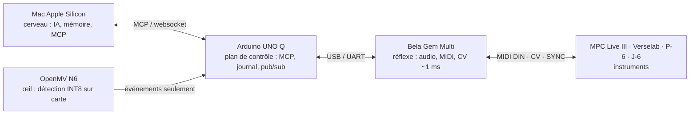

# Atelier matériel — six projets pour les cartes et instruments disponibles

> Inventaire du matériel réellement en main et six fiches de projet qui
> s'y appuient, chacune reliée à un module existant du dépôt. Statuts honnêtes,
> au sens de [`TECHNICAL_REALITY.md`](../klod-live-brain/docs/TECHNICAL_REALITY.md) :
> **PROUVÉ** (exécuté et chiffré ici), **FAISABLE** (specs vérifiées, non mesuré),
> **EXPÉRIMENTAL** (hypothèse à tester), **INCONNU** (aucune source fiable).
> Rien n'est codé dans cette PR : c'est le cadrage, pas la preuve.

## 1. Inventaire vérifié

Chaque ligne a été recoupée sur au moins deux sources (constructeur + presse
spécialisée ou revendeur). Les chiffres de latence sont ceux des constructeurs,
jamais mesurés ici.

| Appareil | Rôle naturel | Capacités clés (vérifiées) | Niveau |
|---|---|---|---|
| **Arduino UNO Q** | Passerelle Linux + MCU | Qualcomm Dragonwing QRB2210 (4× Cortex-A53, Debian) **et** STM32U585 (Cortex-M33, Zephyr), reliés par le RPC « Bridge » ; Wi-Fi 5, BT 5.1, USB 3.1, MIPI-CSI ; App Lab avec « Bricks » IA, Python exécuté en conteneur | VÉRIFIÉ |
| **Bela Gem Multi** | Réflexe audio / CV temps réel | Carte fille pour **PocketBeagle 2** ; 10 in / 10 out 24 bit 96 kHz ; **8 sorties DC-couplées ±5 V (CV)** ; 8 entrées analogiques 16 bit ; 16 GPIO 3,3 V ; USB-A hôte ; C++, Pure Data, SuperCollider, FAUST, Csound ; **~1 ms** bout à bout (chiffre Bela) | VÉRIFIÉ |
| **OpenMV N6** | Œil edge | STM32N657 : Cortex-M55 800 MHz + NPU 1 GHz **600 GOPS INT8** ; YOLOv8n ~30 fps à 256×256 sous 0,75 W (chiffre ST) ; capteur 1 MP **global shutter 120 fps** ; micro, IMU 6 axes ; Wi-Fi, BLE 5.1, USB-C, Ethernet (PHY sans RJ45) ; MicroPython | VÉRIFIÉ |
| **Akai MPC Live III** | Instrument / séquenceur maître | **8 sorties CV/Gate** ; 2 MIDI DIN bidirectionnels ; USB-C class compliant (24 canaux audio, 32 MIDI) ; Ableton Link ; séparation de stems (zplane) ; micro intégré ; 8 cœurs, 8 Go RAM, batterie ~4 h | VÉRIFIÉ (hôte USB pour périphériques : INCONNU) |
| **Roland Verselab MV-1** | Instrument voix + ZEN-Core | MIDI DIN in/out ; USB-B audio + MIDI ; XLR 48 V ; 7 pistes + 1 piste vocale ; séquenceur 128 pas | VÉRIFIÉ |
| **Roland AIRA Compact P-6** | Sampler de poche | Moteur granulaire ; 48 samples ; séquenceur 64 pas avec **micro-timing, probabilité, hors grille** ; micro ; USB-C audio + MIDI ; MIDI TRS 3,5 mm ; SYNC in/out | VÉRIFIÉ |
| **Roland AIRA Compact J-6** | Synthé d'accords | Moteur Juno-60 (ACB) ; 100 jeux d'accords ; séquenceur 64 pas × 64 patterns ; USB-C audio + MIDI ; MIDI TRS 3,5 mm ; SYNC in/out | VÉRIFIÉ |

### Détails de connectique qui comptent

- **MIDI TRS des AIRA Compact = type A** (Roland, article officiel J-6 ;
  câbles Boss recommandés). Un câble type B (Arturia) ou un câble audio
  ordinaire ne fonctionne pas.
- **SYNC des AIRA Compact = impulsion analogique**, ni MIDI ni DIN sync.
  Jack **mono (TS)** obligatoire, un câble stéréo ne marche pas (manuel T-8).
  Résolution réglable par le menu `S.cLK` : **1, 2, 3, 4, 6, 8, 12 ou 24**
  impulsions par temps (article Roland « The Basics »). Compatible Eurorack et
  Volca (Roland + retour utilisateur). **Tension de l'impulsion : INCONNUE**,
  à mesurer avant de l'envoyer sur une entrée 3,3 V. Ne jamais brancher une
  source audio sur SYNC OUT (risque de dégât, note Sweetwater).
- Le **MPC Live III est le seul avec du MIDI DIN natif**. Les AIRA n'ont que
  du TRS et de l'USB ; le Verselab a du DIN.

### Lecture d'ensemble

Ces cartes sont exactement les quatre niveaux de
[`ARCHITECTURE.md`](../klod-live-brain/docs/ARCHITECTURE.md) :

Le LLM reste hors de la boucle temporelle critique, comme partout ailleurs
dans le dépôt. Les six fiches ci-dessous ne demandent **aucun achat** sauf la
PocketBeagle 2 si elle manque, et des câbles.

---

## 2. Les six fiches

### Fiche 1 — GrooveDNA sur Bela : le processeur de groove entre MPC et CV

**Statut : FAISABLE. Priorité 1.**

- **Quoi.** Le MPC envoie un pattern en MIDI DIN. La Bela applique
  `apply_groove` (porté de [`groove.py`](../klod-live-brain/host/groovedna/groove.py)
  en C++) et renvoie le pattern humanisé en MIDI DIN vers le MPC et en CV/Gate
  sur ses 8 sorties ±5 V.
- **Pourquoi celle-ci d'abord.** Elle produit le `BENCHMARKS.md` que
  `TECHNICAL_REALITY.md` attend du Teensy : jitter, latence, overruns,
  **mesurés** avec l'oscilloscope et l'horloge temps réel de Bela. C'est le
  critère §38 bouclé et chiffré, condition que le dépôt se fixe avant tout
  passage à l'IA.
- **M0 (sans la carte).** Porter `apply_groove` en C++ pur avec les 35 cas de
  `test_groove.py` rejoués en natif (`g++`), comme la file bornée du firmware.
  Zéro matériel, preuve de parité exacte Python ↔ C++.
- **M1 (avec la carte).** MIDI DIN in → Bela → MIDI DIN out, horodatage de
  chaque note en entrée et en sortie, histogramme du jitter sur une session de
  30 min. Puis CV/Gate.
- **Risque.** Le jitter du MIDI DIN côté MPC est inconnu ; s'il dépasse celui
  de Bela, on mesure le MPC et non la Bela. Le banc SYNC de la fiche 6 sert de
  référence externe.

### Fiche 2 — TinyGuard réel : OpenMV N6 perçoit, UNO Q décide

**Statut : FAISABLE. Priorité 2, parallélisable avec la fiche 1 (aucun matériel commun).**

- **Quoi.** Détection de personnes (et de chutes, par pose) sur la N6 ;
  **aucune image ne quitte la carte**, seuls des événements horodatés partent
  vers l'UNO Q. Côté Linux de l'UNO Q : serveur MCP et le **journal chaîné
  SHA-256** déjà écrit dans `edgesense/devices.py`
  ([PR #4](https://github.com/klodynlov/klodynlov/pull/4), non mergée).
- **Lien portfolio.** C'est le projet B de la PR #4 qui passe de
  « conception » à « codé », et le pilier *accompagnement* de SilverBrain
  avec un argument de confiance vérifiable (aucun flux vidéo sortant).
- **M0.** Modèle YOLO INT8 fourni par OpenMV, script MicroPython qui émet un
  événement JSON sur UART/USB à chaque détection stable (N trames). Mesurer
  fps, consommation, faux positifs sur 1 h.
- **M1.** UNO Q reçoit, journalise, expose `tinyguard://events` en MCP ;
  notification locale (LED, écran, ou SilverBrain).
- **Risque.** La détection de chute par pose sur un modèle sub-1B INT8 est
  **EXPÉRIMENTALE** (plancher de précision noté dans
  `docs/aiot-edge-projects.md`, [PR #4](https://github.com/klodynlov/klodynlov/pull/4)). Commencer
  par présence/absence, qui est PROUVABLE.

### Fiche 3 — EdgeSense M1 et M2 sans Raspberry Pi

**Statut : FAISABLE.**

- **Quoi.** Le STM32U585 lit les capteurs de façon déterministe sous Zephyr ;
  le côté Linux fait MCP, SQLite et le bus pub/sub prévu au jalon M2 de la
  PR #4.
- **Le point précieux.** Bridge pousse **du MCU vers Linux**, puis Linux
  pousse vers le Mac en websocket. C'est le test du **risque n°1** (« MCP ne
  pousse pas ») laissé ouvert par EdgeSense, micro:bit et KLOD Live Brain.
- **M0.** Capteur de température réel sur le MCU, seuil franchi → événement
  Bridge → websocket → client Mac. Mesurer la latence capteur → Mac sur
  1 000 événements.
- **Contrainte.** App Lab exécute Python en conteneur et ses Bricks ne sont
  pas accessibles depuis l'IDE Arduino classique. Prévoir Debian direct pour
  le serveur MCP (même code que `edgesense/server.py`).

### Fiche 4 — Jouer avec le corps : OpenMV N6 → MIDI vers J-6 et MPC

**Statut : FAISABLE pour la modulation, EXPÉRIMENTAL pour le déclenchement de notes.**

- **Quoi.** Suivi de mains ou de pose à ~30 fps sur la N6, converti en
  messages MIDI : changements d'accords vers le **J-6** (main gauche / droite,
  hauteur), CC de modulation vers le MPC (Q-Link, filtre).
- **Budget honnête.** 30 fps donnent ~33 ms, plus la transmission. C'est
  acceptable pour des accords et de la modulation, **trop lent pour
  déclencher des notes en rythme**. Le dire dans la doc évite d'annoncer un
  contrôleur gestuel « temps réel » qui ne l'est pas.
- **M0.** Mesurer la latence caméra → message MIDI reçu (horodatage côté
  Bela ou UNO Q) avant d'écrire une seule ligne de mapping musical.
- **Câblage.** MIDI TRS **type A** vers le J-6 ; USB class compliant ou DIN
  vers le MPC.

### Fiche 5 — Bela comme boîte d'effets voix pour le Verselab (~1 ms)

**Statut : FAISABLE. Petit projet, démonstration très lisible.**

- **Quoi.** Le Verselab est orienté voix (XLR, phantom, piste vocale) mais n'a
  ni CV ni effets externes à faible latence. Une Bela en Pure Data entre ses
  sorties mix et son entrée ligne fait harmoniseur ou vocodeur, pilotée en
  MIDI DIN par le Verselab lui-même.
- **M0.** Patch Pure Data passthrough + mesure de la latence réelle
  entrée → sortie à l'oscilloscope (le « ~1 ms » devient un chiffre mesuré
  ou non).
- **Pourquoi c'est utile au dépôt.** Première occurrence d'un chiffre de
  latence audio **mesuré ici** et non déclaré, réutilisable dans
  `TECHNICAL_REALITY.md`.

### Fiche 6 — Banc SYNC : horloge électrique des AIRA comme référence de mesure

**Statut : FAISABLE, tension INCONNUE à mesurer d'abord.**

- **Quoi.** Le SYNC OUT du P-6 ou du J-6 réglé à 24 impulsions par temps est
  une horloge électrique propre, bien plus simple à horodater qu'une trame
  MIDI série. Lue par un GPIO de la Bela ou le STM32 de l'UNO Q, elle sert de
  **référence externe** pour mesurer le jitter des notes MIDI émises par ces
  mêmes appareils, et par ricochet celui de la chaîne de la fiche 1.
- **Précautions.** Mesurer la tension au multimètre avant tout branchement
  (logique 3,3 V côté Bela et UNO Q ; pont diviseur ou entrée analogique si
  5 V). Câble **mono**.
- **M0.** Compter les impulsions sur 10 min à 120 BPM : attendu 24 × 120 × 10
  = 28 800, écart = perte ou rebond. Puis histogramme des intervalles.
- **Bonus GrooveDNA.** Le P-6 séquence nativement **hors grille avec
  micro-timing** : un pattern P-6 capturé en MIDI donne des offsets réels
  sans jouer au clavier, et le P-6 peut rejouer un pattern humanisé par
  `apply_groove`. C'est le meilleur instrument de test du moteur disponible
  dans l'atelier.

---

## 3. Ordre proposé et ce qui est à ne pas faire

1. **Fiche 6** (un après-midi, 0 €) puis **fiche 1** : la référence de mesure
   avant la chose mesurée.
2. **Fiche 2** en parallèle, matériel disjoint.
3. **Fiches 3, 4, 5** réutilisent les mêmes cartes sans nouvel achat.

⛔ À ne pas faire, en cohérence avec `TECHNICAL_REALITY.md` : LLM sur une
carte temps réel ; annoncer « temps réel » ou « faible latence » sans mesure
(§30) ; grooves de styles inventés plutôt qu'appris de vrais fichiers (§7) ;
passer à l'IA avant que la chaîne §38 soit bouclée et chiffrée.

## 4. Sources

Spécifications : datasheet Arduino UNO Q (ABX00162/ABX00173) ; blog Arduino
« App Lab updates » (déc. 2025) ; blog Bela « Meet Bela Gem: Stereo & Multi » et
boutique Bela ; CNX Software (Bela Gem, OpenMV N6) ; docs OpenMV N6 ; blog ST
(STM32N6) ; Sound On Sound et Thomann (MPC Live III) ; test bonedo (MPC Live 3) ;
Roland (J-6), zZounds et MusicRadar (Verselab MV-1) ; MusicTech et DJ Mag (P-6).
Connectique AIRA : articles Roland « Getting to Know AIRA Compact » (J-6, The
Basics) ; manuel T-8 v1.02 ; Sweetwater « How To Sync AIRA Compact » et
« Quickstart » ; fils Gearspace et Elektronauts (type A, synchro Volca).

Les sites Roland, Sweetwater et Gearspace étaient bloqués par le proxy de la
session de rédaction : leurs contenus ont été lus via les extraits indexés,
d'où le statut INCONNU sur la tension SYNC.
